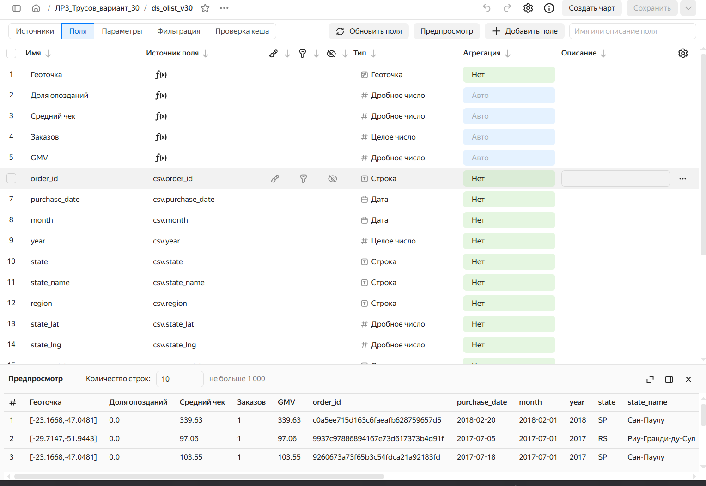
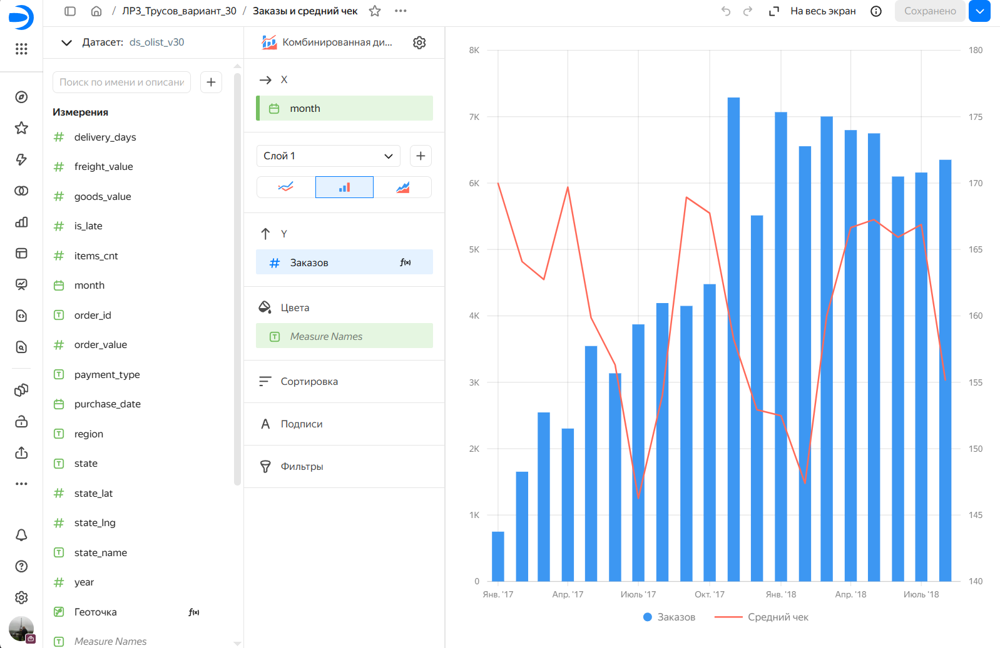

# ЛР-3. Аналитический дашборд для бизнес-кейса — вариант 30

**Студент:** Трусов А.И. · **группа:** БД-251м
**Бизнес-кейс:** Дашборд руководителя e-commerce (эталон преподавателя)

## Цель работы
Как чувствует себя бизнес в целом: выручка, заказы, средний чек, география, способы оплаты, доставка и удовлетворённость клиентов?

## Исследуемые метрики
- **GMV** = `SUM([order_value])`
- **Заказов** = `COUNTD([order_id])`
- **Средний чек** = `SUM([order_value]) / COUNTD([order_id])`
- **Доля опозданий** = `AVG([is_late])`
- **Геоточка** = `GEOPOINT([state_lat], [state_lng])`

## Архитектура решения
Kaggle (Olist, 9 CSV) → Python (`urllib`, `pandas`) → SQLite: RAW → STAGING → CORE → витрина `dm_v30_executive` → CSV → Yandex DataLens.

## Технологический стек
Python 3.13.18, pandas 2.2.3, SQLite 3.45.1, Google Colab / Jupyter, Yandex DataLens.

## Схема данных
Слои: `raw_*` (9 таблиц) → `stg_*` (типизация, очистка) → `core_order`, `core_item`, `dim_state` → `dm_v30_executive` (VIEW).
<!-- вставьте скриншот или ER-диаграмму: img/er.png -->

## SQL витрины
```sql
CREATE VIEW dm_v30_executive AS
SELECT order_id,
       purchase_date,
       purchase_month AS month,
       purchase_year AS year,
       customer_state AS state,
       state_name,
       region,
       state_lat,
       state_lng,
       COALESCE(payment_type, 'unknown') AS payment_type,
       items_cnt,
       goods_value,
       freight_value,
       order_value,
       delivery_days,
       is_late,
       review_score
FROM core_order
WHERE order_status = 'delivered'
  AND purchase_month BETWEEN '2017-01-01' AND '2018-08-01'
```

## Контрольные значения
| Вопрос | Ответ |
|---|---|
| GMV за янв 2017 – авг 2018, млн BRL | 15.37 |
| Средний чек, BRL | 159.79 |

## Дашборд DataLens
Ссылка: <!-- https://datalens.yandex/2efiwk4mhcx6l?_share_link=public-->

| № | Тип | Название |
|---|---|---|
| 1 | Индикатор | GMV, BRL |
| 2 | Линейная диаграмма | Выручка по месяцам |
| 3 | Столбчатая диаграмма | Выручка по регионам |
| 4 | Кольцевая диаграмма | Способы оплаты |
| 5 | Комбинированная диаграмма | Заказы и средний чек |






## Выводы и бизнес-рекомендации
1. **Экстенсивный рост оборота при стабильном среднем чеке:** за январь 2017 – август 2018 гг. выручка доставленных заказов (`GMV`) достигла **15,37 млн BRL** (**96 211** заказов). Месячный оборот вырос в **7,7 раза** (со **127,5 тыс. BRL** в январе 2017 г. до плато **0,99–1,13 млн BRL** в марте–августе 2018 г., пик — **1,15 млн BRL** в ноябре 2017 г.) при стабильном среднем чеке **159,79 BRL** (коридор 146–170 BRL).
2. **Высокая географическая концентрация и логистическое неравенство:** макрорегион **Юго-Восток** (`Sudeste`) формирует **64,6% всей выручки** (**9,93 млн BRL**, `66 027` заказов), включая **37,4%** по одному штату Сан-Паулу (`SP`). В удалённых регионах сроки и опоздания вдвое выше: **20,0 дн.** и **12,8% опозданий** на Северо-Востоке (`1,82 млн BRL`, `11,8% GMV`), **22,6 дн.** и **8,6%** на Севере против **10,7 дн.** и **6,1% опозданий** на Юго-Востоке.
3. **Доминирование кредитных карт и критическое влияние опозданий на рейтинг:** **78,5% GMV** (**12,06 млн BRL**) оплачивается кредитными картами (средний чек **166,09 BRL** за счёт рассрочки), **18,0%** — через *boleto* (**144,32 BRL**). При доставке вовремя средняя оценка клиента составляет **4,29**, но при опоздании падает почти вдвое — до **2,27** (общий рейтинг — **4,16**, доля опозданий — **6,79%**).
4. **Управленческая рекомендация:** открыть партнёрский распределительный центр (3PL) и привлечь локальных продавцов в макрорегионе **Северо-Восток** (штаты `BA`, `PE`), а также скорректировать расчёт обещанных сроков доставки (`estimated_date`) для межрегиональных заказов. Снижение доли опозданий на Северо-Востоке с **12,8%** до уровня Юго-Востока (**6,1%**) позволит предотвратить около **450–500 негативных отзывов (1–2 звезды)** в год и повысить повторные продажи.
